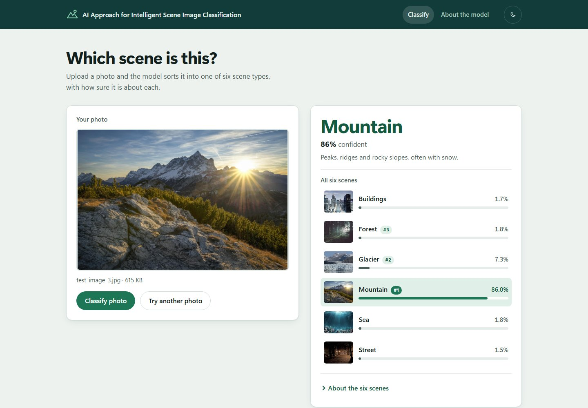

# AI Approach for Intelligent Scene Image Classification

**Team B2 · Dept. of AIML, Dayananda Sagar College of Engineering · III semester project**

A web app that looks at a photo and says which of six scene types it shows (**buildings, forest, glacier, mountain, sea, street**), how confident it is, and how likely each of the other scenes is. It uses a ResNet50 deep-learning model fine-tuned on the [Intel Image Classification](https://www.kaggle.com/datasets/puneet6060/intel-image-classification) dataset, served by a small Flask backend.



> **Model status:** the model in this repo was retrained by Team B2 on 22 November 2026 and scores **93.1% on the 3,000 test photos**. The original repo shipped an untrained model (see [Project history](#project-history-and-credits)). The ResNet50 backbone is frozen and only the classifier head was trained, which works on an ordinary laptop CPU ([steps below](#retrain-on-your-own-computer-cpu-no-gpu-needed)). For a few more percent, also fine-tune the last ResNet block with `train_resnet50_v2.ipynb` on Kaggle's free GPU ([steps](#retrain-the-model-on-kaggle)).

---

## Features

- **Upload, drag and drop, or paste** a photo (JPG, PNG, WEBP, BMP or GIF, up to 10 MB), with a preview.
- **Results without reloading the page**: the predicted scene, the confidence, and a bar for **all six scenes** with the top 3 ranked.
- **Honest uncertainty**: a "Not sure" warning when no scene reaches 50%.
- **11 sample photos** you can click to test the model, captioned with what each photo really shows.
- **Recent results**, saved only in your browser.
- **Light and dark mode**: follows your system setting, with a toggle.
- **About the model** page: how it works, test accuracy, per-scene scores and the confusion matrix (filled in automatically after retraining), training setup, limitations and credits.
- **Never crashes on bad input**: no file, wrong file type or too-big files get a clear message instead of an error page.
- **Accessible**: works with the keyboard, results are announced to screen readers, text meets WCAG AA contrast, and it still works without JavaScript.
- **JSON API** (`POST /api/predict`) for other programs.

## Project structure

```
app.py                          Flask app: routes, validation, model loading, prediction
templates/
  base.html                     Shared layout (header, theme toggle, footer)
  index.html                    Classify page
  about.html                    About the model page
  error.html                    Friendly 404 / 500 page
static/
  css/style.css                 All styles (light and dark themes)
  js/app.js                     Upload, preview, validation, results, samples, history
  js/theme.js                   Light/dark toggle
  thumbs/                       Small versions of the sample photos
  test_image_*.jpg              sample photos (11 shown in the app)
  favicon.svg
natural_scenes_image_resnet_classifier.pt   Model weights used by the app
model_meta.json                 Input size, classes and test results of the current model (read by the app)
training/
  extract_features.py           CPU training step 1: ResNet50 features for every photo
  train_head.py                 CPU training step 2: train the head, test it, save the model
train_resnet50_v2.ipynb         GPU training notebook that also fine-tunes layer4 (run on Kaggle)
natural-scenes-image-classification-using-cnns.ipynb   Original notebook (kept for reference)
requirements.txt                Python packages (pinned versions)
Dockerfile, .dockerignore       Container setup (CPU-only)
docs/                           Screenshots for this README
```

## How it works

1. **Prepare the photo.** It is resized to 224 × 224 pixels (128 × 128 for the old model) and normalised the same way as during training.
2. **Extract features.** ResNet50, pre-trained on ImageNet's 1.2 million photos, turns the image into 2,048 numbers that describe what it sees.
3. **Classify.** A small head (2048 → 512 → 128 → 6, ending in LogSoftmax) turns those numbers into a probability for each scene. The highest one is the answer.

## Run it on your computer

You need **Python 3.10–3.12**.

### Windows (PowerShell)

```powershell
git clone https://github.com/vmahammadakheel1401/Intelligent-scene-classification.git
cd Intelligent-scene-classification
python -m venv .venv
.\.venv\Scripts\Activate.ps1
pip install torch==2.15.0 torchvision==0.29.2 --index-url https://download.pytorch.org/whl/cpu
pip install -r requirements.txt
python app.py
```

Then open **http://127.0.0.1:8000**.

If PowerShell refuses to run `Activate.ps1`, run `Set-ExecutionPolicy -Scope CurrentUser RemoteSigned` once, then try again.

### macOS / Linux

```bash
python3 -m venv .venv
source .venv/bin/activate
pip install torch==2.15.0 torchvision==0.29.2 --index-url https://download.pytorch.org/whl/cpu
pip install -r requirements.txt
python app.py
```

The first command installs the small CPU-only version of PyTorch. If you have an NVIDIA GPU, you can install PyTorch from [pytorch.org](https://pytorch.org/get-started/locally/) instead; the app uses the GPU automatically.

### Options

| Environment variable | Default | What it does |
|---|---|---|
| `PORT` | `8000` | Port for `python app.py` |
| `FLASK_DEBUG` | off | Set to `1` for development error pages (never in a demo or on a server) |
| `MODEL_PATH` | `natural_scenes_image_resnet_classifier.pt` | Use a different model file |
| `MODEL_META_PATH` | `model_meta.json` | Use a different metadata file |

## Run it with Docker

```bash
docker build -t scene-classifier .
docker run -p 8000:8000 scene-classifier
```

Then open http://localhost:8000. The image uses CPU-only PyTorch and runs gunicorn with 2 workers.

## Retrain on your own computer (CPU, no GPU needed)

This is how the model in this repo was made. It takes about 45 minutes on a laptop CPU, almost all of it in step 2.

1. Install the extra package: `pip install pyarrow`
2. Download the dataset (about 258 MB) from the public Hugging Face mirror [sfarrukhm/intel-image-classification](https://huggingface.co/datasets/sfarrukhm/intel-image-classification), which has the same 14,034 training and 3,000 test photos as the Kaggle original:

   ```powershell
   mkdir data/hf
   curl.exe -L -o data/hf/train.parquet "https://huggingface.co/datasets/sfarrukhm/intel-image-classification/resolve/refs%2Fconvert%2Fparquet/default/train/0000.parquet"
   curl.exe -L -o data/hf/test.parquet "https://huggingface.co/datasets/sfarrukhm/intel-image-classification/resolve/refs%2Fconvert%2Fparquet/default/test/0000.parquet"
   ```

   (`data/` is in `.gitignore`, so the dataset is never committed.)
3. Turn every photo into ResNet50 features (the slow part, done once): `python training/extract_features.py data/hf V2`
4. Train the head, test it and save the model (takes about a minute): `python training/train_head.py data/hf/features_V2.pt . --save`
5. Restart the app. The About page now shows the new results from `model_meta.json`.

How it works: the ResNet50 backbone (ImageNet weights) is frozen, so each photo only has to go through it once. Its 2,048 features, for the photo and its mirror image, are saved, and the small head is trained on them for 40 epochs. 10% of the training photos are held back to pick the best epoch, and the 3,000 test photos are used only once, for the final score.

## Retrain the model on Kaggle

Fine-tunes the last ResNet block as well, which should add a few percent. Takes about 30–45 minutes on Kaggle's free GPU.

1. On Kaggle: **Create → New Notebook → File → Import Notebook**, and choose `train_resnet50_v2.ipynb`.
2. Right panel: **Add Input**, search **intel-image-classification** (by *puneet6060*), and add it.
3. **Session options:** Accelerator **GPU T4 x2** (or P100), Internet **On** (needed to download the ImageNet weights; requires a phone-verified Kaggle account).
4. **Run All.**
5. From the **Output** panel, download `natural_scenes_image_resnet_classifier.pt` (about 49 MB) and `model_meta.json`.
6. Put both files in the project folder (replace the old `.pt`), restart the app, and commit them.

What the v2 notebook fixes compared with the original:

| Original | v2 |
|---|---|
| Random **vertical** flips (upside-down mountains and seas) | Horizontal flips only, rotation ±10° |
| 128 px input | 224 px (the size ResNet50 was trained at) |
| Whole backbone frozen | `layer4` fine-tuned with a 10× smaller learning rate |
| Validation images were augmented | Validation uses test-time transforms |
| Loss logged from the last batch only | Averaged over every batch |
| Gradient clipping before `backward()` (no effect) | Clipping after `backward()` |
| `StepLR.step(val_loss)`, so the learning rate never dropped | Cosine schedule, stepped once per epoch |
| Last epoch saved | Best validation epoch saved |
| 99 MB pickled model | 49 MB half-precision weights, loadable with PyTorch's safe loader |

## Results

| Model | Test accuracy (3,000 photos) | Notes |
|---|---|---|
| Original custom CNN (original notebook) | 80.7% | Reported in the original notebook |
| Original ResNet50 (original notebook) | 86.1% | Reported, but the trained file was never published |
| ResNet50 v2, head trained on CPU (this repo) | **93.1%** | Frozen backbone, 224 px, 22 November 2026 |
| ResNet50 v2 with layer4 fine-tuned (Kaggle notebook) | not run yet | Expected around 92–94% |

Per-scene precision/recall and the confusion matrix are on the app's **About the model** page.

## API

`POST /api/predict` with a form field called `image`:

```bash
curl -F "image=@static/test_image_3.jpg" http://127.0.0.1:8000/api/predict
```

```json
{
  "ok": true,
  "label": "mountain",
  "confidence": 0.9312,
  "low_confidence": false,
  "description": "Peaks, ridges and rocky slopes, often with snow.",
  "top3": [{"label": "mountain", "probability": 0.9312}, {"label": "glacier", "probability": 0.0521}, {"label": "sea", "probability": 0.0074}],
  "probabilities": [{"label": "buildings", "probability": 0.0011}, "... all six ..."],
  "filename": "test_image_3.jpg"
}
```

(Example values.) Errors return `{"ok": false, "error": "..."}` with status 400 (bad file), 413 (over 10 MB) or 503 (model not loaded).

## Sample photos

All 12 photos in `static/` come from the original repository, which does not say where they were taken from. `test_image_7.jpeg` carries a tiled **"Unsplash+"** watermark (a paid stock licence), so the app no longer shows it in the sample gallery. Replace it with a freely licensed beach or sea photo (for example from Pexels or the free Unsplash licence) and record the source here.

| File | Shows | Source |
|---|---|---|
| test_image_1 … test_image_12 | see captions in the app | original repository, source not recorded |
| static/thumbs/* | small copies of the above | generated from the originals by Team B2 |

## Known limitations

- The model only knows six scenes. Any other photo (a room, a person, a desert) still gets one of the six answers, which is why low-confidence results are flagged.
- Glacier vs mountain and street vs buildings are the most common mix-ups.
- Training photos are only 150 × 150 px, so fine detail in large photos is lost.

## Project history and credits

This project builds on **[sayamalt/natural-scenes-image-classification-using-cnns](https://github.com/sayamalt/natural-scenes-image-classification-using-cnns)** by Sayam Kumar. The original notebook, the model design, the sample photos and the first version of the Flask app come from that repository, which does not state a license.

What Team B2 added or changed:

- Found that the model file in the repo was untrained (classifier head at random initialisation, ~17% per class), retrained it (93.1% test accuracy) with the scripts in `training/`, and wrote `train_resnet50_v2.ipynb` with the original notebook's training bugs fixed.
- Rewrote the backend: input validation, friendly errors instead of crashes, top-3 and all-class probabilities, a JSON API, a 10 MB upload limit, debug mode off by default, a safe weights-only model loader.
- Rebuilt the whole interface: preview, drag and drop, samples, confidence bars, uncertainty warning, history, dark mode, mobile layout, accessibility, About page.
- Cleaned the repo (removed broken Git LFS pointer files, pinned versions, smaller CPU Docker image) and wrote this README.

Dataset: [Intel Image Classification](https://www.kaggle.com/datasets/puneet6060/intel-image-classification) (originally published by Intel for an Analytics Vidhya challenge).

## Team B2

| Name | USN | Role |
|---|---|---|
| *[name]* | *[USN]* | *[role]* |
| *[name]* | *[USN]* | *[role]* |
| *[name]* | *[USN]* | *[role]* |

Guide: *[faculty name]*
